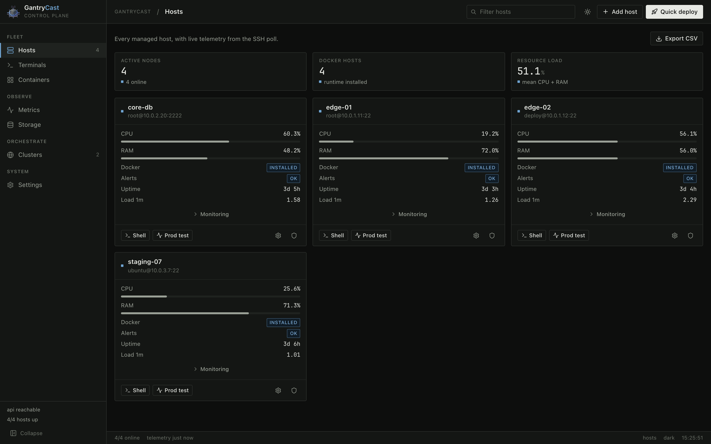

# GantryCast

GantryCast is a self-hosted web control plane for a fleet of Linux servers running
Docker. It connects to hosts over SSH, so nothing has to be installed on the target
machines beyond the container runtime itself.




## Stack

- React 19 + TypeScript 5.8 + Vite 8 + Tailwind CSS 4 (frontend, `src/`)
- Express 4 backend bundled with esbuild (`server.ts` → `dist/server.js`)
- `ssh2` for SSH, `ws` for the terminal WebSocket

One Node process serves both the API and the built frontend. There is no desktop
shell and no native packaging step.

## Prerequisites

- Node.js 22 or newer, and npm
- SSH access to the Linux hosts you want to manage, with sudo for the deploy steps

## Local development

```bash
npm install
npm run dev
```

## Development Note:

This project was developed using AI-assisted workflows.

Note: Old version of this project was made private, after major overhaul. 
(Initial work on this began in April 2026 under KubeCast, since then the scope of the project changed)

## License

See [LICENSE](LICENSE).
